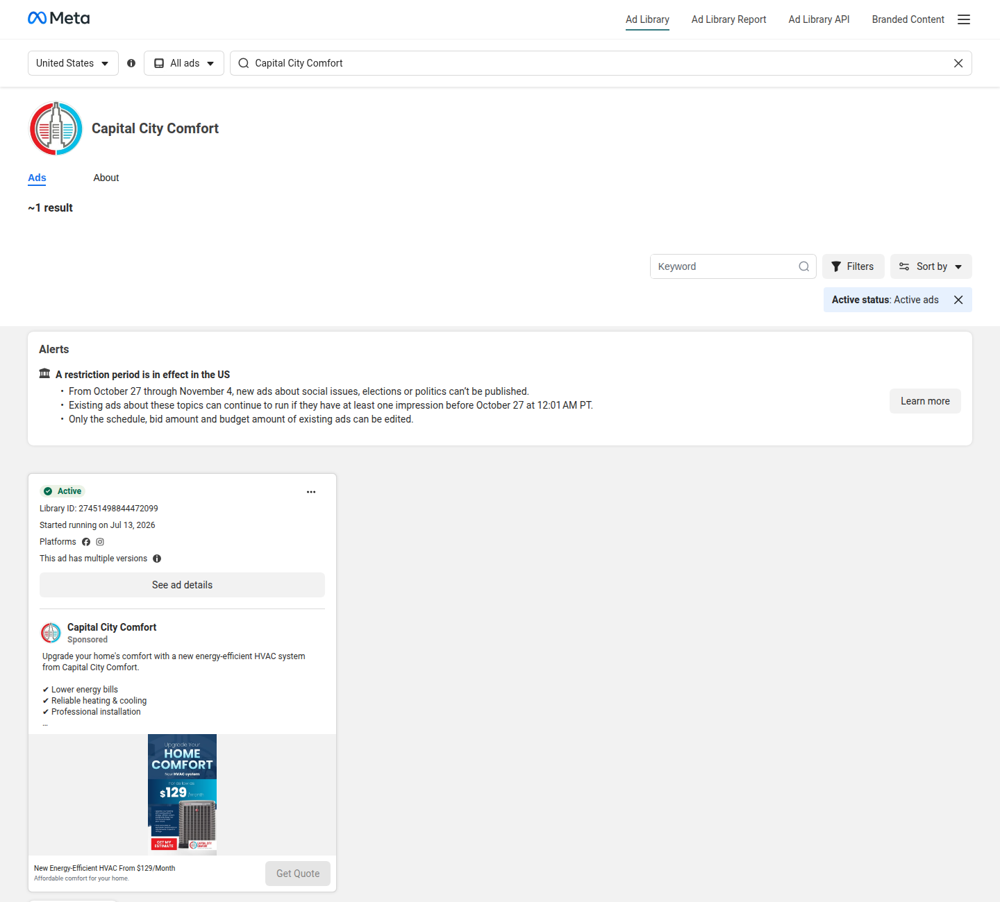
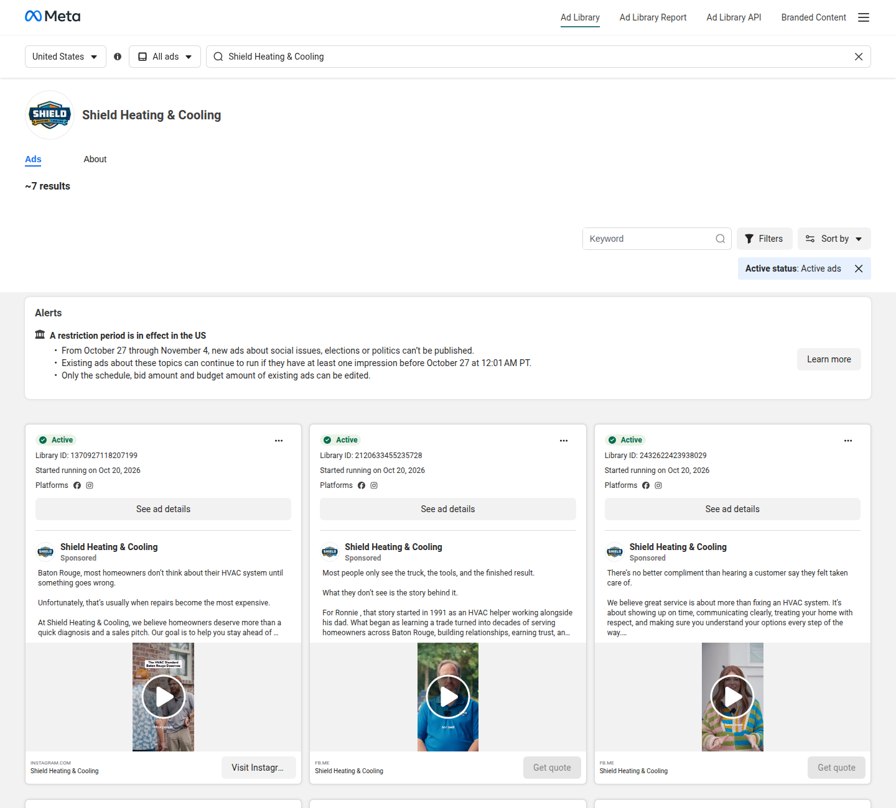
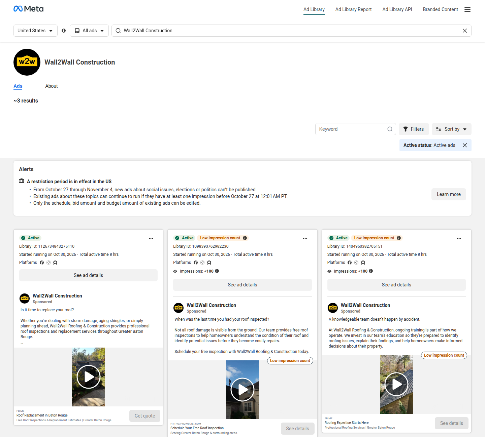
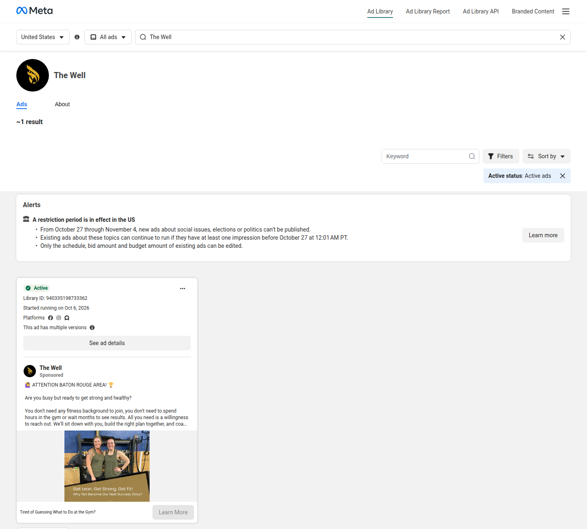

# Baton Rouge / Denham Springs Meta Ad Library audit

Observed **2026-10-30** in Chrome against the official Meta Ad Library. Filters on every named-page check: **United States**, **All ads**, **Active ads**. No ads were bought, no outreach was sent, and the old campaign queue was not touched. This audit does not mark M2 complete.

A row below is tied to a Facebook Page only after the library rendered that page's name. Keyword search is not that check. Searching the words "Resolute Fitness" returned a different advertiser, Resolute Training, [Library ID 2298157767647764](https://www.facebook.com/ads/library/?id=2298157767647764), plus an unrelated Pocket FM ad. Those cards are not Resolute Fitness in Denham Springs and are not counted below.

Meta also showed this notice on the library during the session: "A restriction period is in effect in the US. From October 27 through November 4, new ads about social issues, elections or politics can't be published." Commercial cards still loaded on the pages that have them. The notice is not a finding about these local businesses.

Screenshots of the named-page results are in [`meta_ads_audit_2026-10-30/`](meta_ads_audit_2026-10-30/). The machine-readable rows are [`audit.json`](meta_ads_audit_2026-10-30/audit.json).

## What was verified

| Page | Market | Named-page result | Library IDs read |
| --- | --- | --- | --- |
| TopDogs Roofing&Sheetmetal LLC | Denham Springs | NOT FOUND IN SEARCH | none |
| Capital City Comfort | Baton Rouge | ACTIVE, about 1 result | 27451498844472099 |
| Cool Kings Heating and Air | Baton Rouge / Denham Springs | NOT FOUND IN SEARCH | none |
| Shield Heating & Cooling | Baton Rouge | ACTIVE, about 7 results | 7 IDs visible; 3 creatives read |
| Wall2Wall Construction | Baton Rouge | ACTIVE, about 3 results | 3 |
| Resolute Fitness | Denham Springs | NOT FOUND IN SEARCH | none |
| Strength Science Studios, LLC | Baton Rouge | NOT FOUND IN SEARCH | none |
| The Well | Baton Rouge | ACTIVE, about 1 result | 940335198733362 |
| Sandbox Training, LLC. | Baton Rouge | NOT FOUND IN SEARCH | none |
| Red Stick Health and Performance | Baton Rouge | NOT FOUND IN SEARCH | none |

`NOT FOUND IN SEARCH` means the named page was open and Meta displayed "No ads match your search criteria" for active ads. That page is **not verified** as a current advertiser. Inactive ads were not searched, so the empty active search stops there.

## Active ads

### Capital City Comfort

- Page: [facebook.com/capital.city.comfortBR](https://www.facebook.com/capital.city.comfortBR/)
- Ad Library page id `688657467993628`: [named-page search](https://www.facebook.com/ads/library/?active_status=active&ad_type=all&country=US&media_type=all&search_type=page&view_all_page_id=688657467993628)
- [Library ID 27451498844472099](https://www.facebook.com/ads/library/?id=27451498844472099), Active, started 2026-07-13, multiple versions
- Angle: new energy-efficient HVAC system, lower bills, professional installation, financing "starting at just $129/month"
- CTA: **Get Quote**
- Website booking path, separate from the ad card: [Housecall Pro online booking](https://book.housecallpro.com/book/Capital-City-Comfort/a823567e666547cbb1c4777a4ebdff0f?v2=true). The fetched document title was "Online booking". No appointment was submitted.

### Shield Heating & Cooling

- Page: [facebook.com/shieldhvacpros](https://www.facebook.com/shieldhvacpros/)
- Ad Library page id `596319463569442`: [named-page search](https://www.facebook.com/ads/library/?active_status=active&ad_type=all&country=US&media_type=all&search_type=page&view_all_page_id=596319463569442)
- The library said about 7 results. These seven Library IDs were on the page. Creative was read for the first three only.

Read:

- [1370927118207199](https://www.facebook.com/ads/library/?id=1370927118207199), started 2026-10-20. Educational copy about waiting until an HVAC repair is expensive. CTA: **Visit Instagram profile**.
- [2120633455235728](https://www.facebook.com/ads/library/?id=2120633455235728), started 2026-10-20. Founder story: Ronnie began as an HVAC helper in 1991. CTA on the card: **Get quote**.
- [2432622423938029](https://www.facebook.com/ads/library/?id=2432622423938029), started 2026-10-20. Service promise about showing up and explaining options. CTA: **Get quote**.

Visible on the same page, creative not opened:

- [1136310275412064](https://www.facebook.com/ads/library/?id=1136310275412064)
- [1586610225947035](https://www.facebook.com/ads/library/?id=1586610225947035)
- [4200080033622436](https://www.facebook.com/ads/library/?id=4200080033622436)
- [1139481018500300](https://www.facebook.com/ads/library/?id=1139481018500300)

The public site [shieldhvacpros.com](https://shieldhvacpros.com/) offers free estimates for installations. This audit did not find a public self-serve calendar URL on that homepage.

### Wall2Wall Construction

- Page: [facebook.com/w2wbuilt](https://www.facebook.com/w2wbuilt/)
- Ad Library page id `185512131307247`: [named-page search](https://www.facebook.com/ads/library/?active_status=active&ad_type=all&country=US&media_type=all&search_type=page&view_all_page_id=185512131307247)
- [1126734843275110](https://www.facebook.com/ads/library/?id=1126734843275110), Active, started 2026-10-30, total active time shown as 8 hours. "Is it time to replace your roof?" Free inspections and replacement estimates. Card destination shown as `FB.ME`, headline "Roof Replacement in Baton Rouge". CTA: **Get quote**.
- [1098393762982230](https://www.facebook.com/ads/library/?id=1098393762982230), started 2026-10-30, Meta label "Low impression count" and impressions under 100. "Schedule your free inspection." Card destination `https://w2wbuilt.com`, headline "Schedule Your Free Roof Inspection". CTA: **See details**.
- [1404950382705151](https://www.facebook.com/ads/library/?id=1404950382705151), started 2026-10-30, same low-impression label. Team-training angle. CTA: **See details**.
- The homepage at [w2wbuilt.com](https://w2wbuilt.com/) says "Get a Free Roof Inspection" and "Complete the form, and we'll be in touch to schedule a thorough evaluation." The ad asks the visitor to schedule; the homepage form is a request that the company then schedules.

### The Well

- Page handle seen in the library typeahead: `@thewell.btr`. Profile URL opened: [The Well](https://www.facebook.com/people/The-Well/61590421362661/).
- Ad Library page id `1146388685224647`: [named-page search](https://www.facebook.com/ads/library/?active_status=active&ad_type=all&country=US&media_type=all&search_type=page&view_all_page_id=1146388685224647)
- [Library ID 940335198733362](https://www.facebook.com/ads/library/?id=940335198733362), Active, started 2026-10-06, multiple versions
- Angle: "ATTENTION BATON ROUGE AREA." Busy people, no fitness background required, small group, "We'll sit down with you, build the right plan together."
- CTA: **Learn More**
- On [thewellstudios.net](https://thewellstudios.net/) the repeated "Book Your Gameplan Session" controls point at `href="#"`. The page describes semi-private sessions of 4 to 6 people at 8681 Siegen Ln. Those buttons do not open a scheduler.

## Named pages with no active ad in this search

These six pages rendered by name and then showed "No ads match your search criteria." Each one is **not verified** as a current advertiser.

### TopDogs Roofing&Sheetmetal LLC

- Page: [facebook.com/3TopDogsLLC](https://www.facebook.com/3TopDogsLLC/), Ad Library page id `161220991477746`
- [Named-page search](https://www.facebook.com/ads/library/?active_status=active&ad_type=all&country=US&media_type=all&search_type=page&view_all_page_id=161220991477746)
- [topdogsroofing.com](https://topdogsroofing.com/) links a **$199 roof tune-up** and a free-estimate path. [The inspection page](https://topdogsroofing.com/book-roofing-estimate-denham-springs) says "Schedule a free roof inspection quicker than ever with our roof estimate calendar. You choose the day, You choose the time" and also shows a contact form with consent to be called or texted. The static HTML showed "No slots available" under AM and PM before a date was chosen, so this pass does not treat that label as proof the calendar has no future openings.
- Screenshot: [named-topdogs.png](meta_ads_audit_2026-10-30/named-topdogs.png)

### Cool Kings Heating and Air

- Page: [facebook.com/CoolkingsheatingandairLLC](https://www.facebook.com/CoolkingsheatingandairLLC/), Ad Library page id `108146504870595`
- [Named-page search](https://www.facebook.com/ads/library/?active_status=active&ad_type=all&country=US&media_type=all&search_type=page&view_all_page_id=108146504870595)
- [coolkingsheatingandair.com](https://www.coolkingsheatingandair.com/) is a Housecall Pro site with a **Book Online** control, maintenance-plan copy (two visits a year, priority scheduling), and financing "subject to approved credit." This pass did not find a public booking URL on the page the way Capital City Comfort publishes one. A Housecall lead-form string for a different company name was present in the site source and is not treated as Cool Kings' funnel.
- Screenshot: [named-kings.png](meta_ads_audit_2026-10-30/named-kings.png)

### Resolute Fitness

- Ad Library typeahead listed "Resolute Fitness", gym, `@resolutefitness_ds`, Ad Library page id `107791292064516`
- [Named-page search](https://www.facebook.com/ads/library/?active_status=active&ad_type=all&country=US&media_type=all&search_type=page&view_all_page_id=107791292064516)
- `https://resolutefitnessds.com/` and `https://www.resolutefitnessds.com/` both returned **404** on 2026-10-30. A 2022 Advocate ribbon-cutting story and a Facebook post about a move exist, and the public addresses in those sources do not match each other. The current storefront was not verified in this pass.
- This is a real independent gym page. It is not a chain. The dead website means pricing and the booking path are **not verified**.
- Screenshot: [named-resolute.png](meta_ads_audit_2026-10-30/named-resolute.png)

### Strength Science Studios, LLC

- Page: [facebook.com/StrengthScienceStudios](https://www.facebook.com/StrengthScienceStudios/), Ad Library page id `245150672839904`
- [Named-page search](https://www.facebook.com/ads/library/?active_status=active&ad_type=all&country=US&media_type=all&search_type=page&view_all_page_id=245150672839904)
- [strengthsciencestudios.net](https://strengthsciencestudios.net/) is a one-on-one studio at 9730 Bluebonnet Blvd, Suite 7. The nav and hero link **Schedule Appointment** to [vagaro.com/strengthsciencestudiosllc](https://www.vagaro.com/strengthsciencestudiosllc). That Vagaro page returned HTTP 200 and the title "Strength Science Studios, LLC - Baton Rouge LA". No appointment was booked.
- Screenshot: [named-strength.png](meta_ads_audit_2026-10-30/named-strength.png)

### Sandbox Training, LLC.

- Ad Library typeahead listed `@SandboxTrainingBatonRouge`, fitness trainer, Ad Library page id `143361279043651`. Opening the profile URL redirected to a Facebook login wall, so the profile body was not read.
- [Named-page search](https://www.facebook.com/ads/library/?active_status=active&ad_type=all&country=US&media_type=all&search_type=page&view_all_page_id=143361279043651)
- [thesandboxtraining.com](https://thesandboxtraining.com/) describes an independent Baton Rouge personal-training studio opened in 2009. The public next step found on the site is the [contact page](https://thesandboxtraining.com/contact/). No Vagaro, Calendly, or Housecall booking link was in the homepage HTML.
- Screenshot: [named-sandbox.png](meta_ads_audit_2026-10-30/named-sandbox.png)

### Red Stick Health and Performance

- Page: [facebook.com/redstickhealthperformance](https://www.facebook.com/redstickhealthperformance/), Ad Library page id `112743192075581`
- [Named-page search](https://www.facebook.com/ads/library/?active_status=active&ad_type=all&country=US&media_type=all&search_type=page&view_all_page_id=112743192075581)
- [redstickhealthperformance.com](https://redstickhealthperformance.com/) is an owner-operated CrossFit and HYROX gym at 3079-C Government St. The membership page lists CrossFit and HYROX unlimited at **$175 per month**, a 10-class pass at $175, a drop-in at **$25**, and a $145 monthly rate for student, military, law enforcement, and first responder ID. Class calendar: [redstickhp.pushpress.com/landing/calendar](https://redstickhp.pushpress.com/landing/calendar).
- Screenshot: [named-redstick.png](meta_ads_audit_2026-10-30/named-redstick.png)

## Three prospects and one gap each

These are public website and Ad Library observations. They are not outreach, and they are not a claim about revenue or ad spend.

1. **TopDogs Roofing&Sheetmetal LLC.** The site already sells a $199 tune-up and tells the visitor to pick a day and time for a free inspection. The named Facebook Page had no active ad in this search. Wall2Wall Construction, a Greater Baton Rouge roofer, had three active ads the same day offering a free inspection and a quote. Gap: TopDogs has a priced offer and a calendar page, and is **not verified** as running an active Meta ad, while a nearby roofer is.

2. **Cool Kings Heating and Air.** The named Page had no active ad in this search. Capital City Comfort's named Page had [Library ID 27451498844472099](https://www.facebook.com/ads/library/?id=27451498844472099) with a $129/month financing offer and a Get Quote button, and Capital City Comfort also publishes a Housecall Pro online-booking link. Gap: Cool Kings describes maintenance plans and a Book Online control, and is **not verified** as running an active Meta ad or as publishing a comparable booking URL.

3. **Sandbox Training, LLC.** The named Page had no active ad in this search, and the live site path found is a contact page. The Well had [Library ID 940335198733362](https://www.facebook.com/ads/library/?id=940335198733362) inviting Baton Rouge visitors into a coached small group, and Strength Science Studios publishes a working Vagaro appointment link. Gap: Sandbox is **not verified** as a current advertiser and does not show a public scheduler.

A related funnel note, not a fourth prospect claim: The Well is an active advertiser, and its homepage "Book Your Gameplan Session" buttons still point at `#`.

## What this pass did not do

- Did not log into Facebook. Profile bodies behind a login wall were not read.
- Did not search inactive or removed ads. A page with no active ad can still have older ads.
- Did not infer spend, ROAS, or lead volume from library cards. Wall2Wall's "impressions under 100" label is Meta's own label on two cards.
- Did not mark M2 complete. Issue #16 already has a separate M2 note for a different set of advertisers. This file is the Baton Rouge / Denham Springs named-page audit only.
- Did not repair n8n, send mail, or change the outreach queue.
